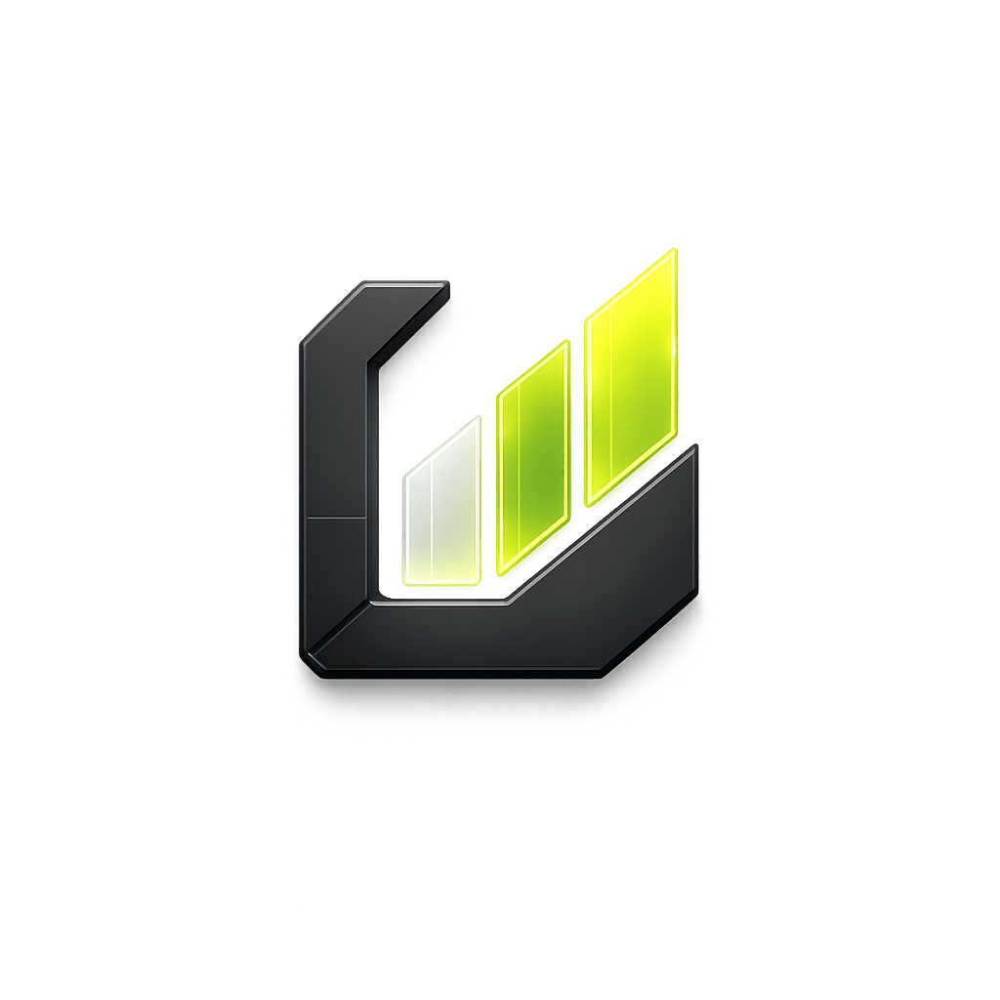
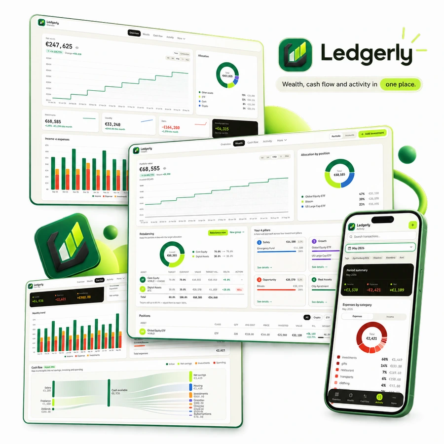

  
  <h1>Ledgerly</h1>
  
<strong>Self-hosted personal net worth &amp; expense tracker</strong> 
  Assets, investments and cash flow in one place.

Ledgerly helps you understand what you own, what you owe and where your money goes.
It brings accounts, investments, income and expenses into a personal financial overview
that you run on your own server. Use it if you want to keep your financial records together
and follow changes over time, on a phone or desktop browser.

  

## Find your way around

- **Overview** brings together net worth, allocation, liquidity and recent movements so you
  can see your financial position at a glance.
- **Wealth** follows assets and investments, their value and performance. Add holdings by
  ticker, record investment purchases and sales, and review allocation and rebalancing targets.
- **Cash Flow** shows income, expenses, category breakdowns and savings over time, helping
  you see how spending affects what you keep.
- **Activity** lets you find and edit movements by period, category and tags. Set up recurring
  income or expenses for regular payments and review upcoming movements.

Under **More**, use **Accounts** to manage cash accounts and debts, **Matrices** to compare
asset values, returns and cash flow across periods, and **Analysis** to explore financial
forecasts over 1–20 years. Forecasts are estimates, not guarantees or financial advice.

Bring existing records through the supported transaction, investment and balance-history
[imports](docs/integrations.md#imports). An optional iPhone Wallet automation records purchases
and sends an in-app notification; browser push notifications are also available when configured.
Wallet automation requires an OpenAI connection. See the [integration guide](docs/integrations.md)
for setup, privacy details and limitations.

## Start using Ledgerly

Ledgerly is self-hosted: you or an administrator install and maintain an instance, then sign in
through a browser. Public registration is disabled. Administrators create member logins, each
with independent financial data, categories and settings. The interface supports English and Italian.

Follow [Getting started](docs/getting-started.md) for installation options and your first accounts
and movements. For a production instance, use the [deployment guide](docs/deployment.md).

## Documentation and project

- [Documentation index](docs/README.md) — user guides, integrations and operations.
- [Development](docs/development.md) and [Contributing](CONTRIBUTING.md) — setup, checks and pull requests.
- [Architecture](docs/architecture.md) — how the application fits together.
- [Product principles](PRODUCT.md) and [Design system](DESIGN.md) — product and interface decisions.
- [Changelog](CHANGELOG.md) and [Code of Conduct](CODE_OF_CONDUCT.md).
